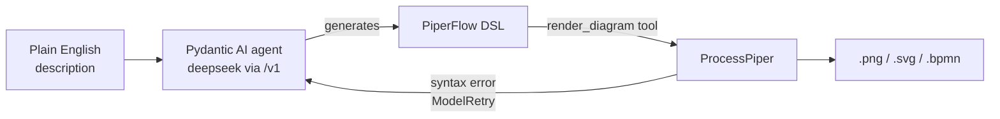

# piperflow-agent

AI agent that generates **BPMN process diagrams** from plain English using
[Pydantic AI](https://pydantic.dev/docs/ai/) and
[ProcessPiper](https://github.com/csgoh/processpiper), against any
OpenAI-compatible local LLM endpoint.

## Why

Processes that actually execute — orchestration, CI, smart contracts — fail
expensively when their control flow is subtly wrong: an XOR split feeding a
parallel join looks correct in a diagram and deadlocks at runtime. Raw LLM
output can't be trusted for that, and formal tools can't be read by process
authors. piperflow-agent chains the pieces, each doing only what it is good at:

- **Plain language in, reviewable artifact out** — describe the process, get a
  diagram plus the PiperFlow DSL it came from: a text file you can commit,
  diff, and regenerate.
- **Proven, not plausible** — every model is checked as a Petri net (can
  complete, always terminates, deadlock-free, no dead activities) before it
  counts as done; a state space that exceeds the bound yields `INCONCLUSIVE`,
  never a false "sound".
- **Behavior witnesses** — one shortest trace per end event (the success path
  and each failure path) and one counterexample per deadlock, so you confirm
  what the model *does*, not just that it is structurally valid.
- **Self-repairing generation** — validate/render errors return to the model
  as targeted repair hints; the delivered DSL has passed both checks.
- **Local and private** — any OpenAI-compatible endpoint on your own
  hardware; process knowledge never leaves your infrastructure.

## How it works



The agent carries the full PiperFlow grammar in its instructions, including
the renderer's hard limits (ProcessPiper rejects any element with more than 4
combined incoming+outgoing connections) and the loop pattern (the back edge
targets a decision gateway — a dedicated entry gateway — never a task). It
emits DSL, calls the `render_diagram` tool, and if ProcessPiper rejects the
syntax the error is fed back (`ModelRetry`) with a targeted repair hint per
error class (undeclared alias, layout crash, connection overload) — up to 6
retries per render call. One renderer bug is fenced off instead of retried:
processpiper 0.8.1 silently displaces every element laid out after a
`(@message/@signal/@conditional ...)` event, so `render_syntax` refuses those
outright and the grammar tells the agent to model sends/receipts as tasks.

## Setup

```bash
uv venv --python 3.12 .venv
uv pip install --python .venv/bin/python -e .
```

## Usage

```bash
# from an argument
.venv/bin/piperflow-agent "An online order process: the customer places an order,
the system validates stock; if available the warehouse ships it and payment is
captured, otherwise the customer is notified and the order cancelled."

# from a file, as SVG + BPMN XML
.venv/bin/piperflow-agent -f process.txt --svg --bpmn --name order-process

# any description language, but force the diagram language
.venv/bin/piperflow-agent -f process.txt --language English --svg --name order-process

Output lands in `./output/` (override with `-o`). The CLI prints the final
PiperFlow DSL, generated file paths, and token usage.

## Configuration

Defaults point at the LAN endpoint. Override by flag or environment variable:

| Env var        | Flag         | Default                          |
|----------------|--------------|----------------------------------|
| `LLM_BASE_URL` | `--base-url` | `http://192.168.0.206:8000/v1`   |
| `LLM_MODEL`    | `--model`    | `deepseek-v4.1-flash`            |
| `LLM_API_KEY`  | `--api-key`  | `local` (ignored by most servers)|
| `LLM_LANGUAGE` | `--language` | (unset — follow the description) |

Programmatic use:
```python
from pathlib import Path
from piperflow import build_agent, RenderDeps

agent = build_agent()  # or build_agent(base_url=..., model=..., language='English')
result = agent.run_sync(
    "Employee onboarding: HR creates the record, IT provisions accounts, "
    "then the manager runs orientation and the buddy plan starts in parallel.",
    deps=RenderDeps(output_dir=Path('output'), fmt='png', export_bpmn=True),
)
print(result.output.diagram_files)
print(result.output.piperflow_syntax)
```

## Process validation (Petri nets)

Every diagram is also verified as a **Place/Transition Petri net** before it
counts as done. The validator checks that the process can actually run and
terminate:

- **can complete** — a marking holding only end-event tokens is reachable
- **always terminates** — every reachable marking can still reach an end
  (catches livelocks / infinite loops)
- **deadlock-free** — every deadlock is a proper end marking
- **no dead activities** — every task fires in at least one reachable state

Mapping semantics: multiple outgoing edges of an activity = implicit
AND-split; multiple incoming edges of an activity = implicit AND-join (add an
explicit exclusive gateway when you want XOR merge — otherwise the validator
reports a deadlock that names the starved task and its fix); exclusive/
inclusive/event gateways = XOR; parallel gateways = fork/join transitions;
timers/message events are pass-through steps (conservative).

Each report also carries **witness traces**: one shortest task sequence per
distinct end event (max 5 — the success path and each failure path), and one
task sequence per deadlock marking (max 5) — what the model can actually do,
not just whether it is structurally sound. `format_report` prints them as
`WITNESS (completion -> <end alias>): Task -> Task` lines, so
`piperflow-validate` and the agent's `validate_process` tool show them
automatically.

Standalone CLI:

```bash
.venv/bin/piperflow-validate examples/re-00-general.txt   # exit 0 = SOUND
```

Exit code is 0 only for `SOUND` (1 otherwise), so it works as a CI gate on
committed `.piperflow` files.

The agent exposes this as the `validate_process` tool (it validates before
rendering and repairs unsound models), and `render_diagram` appends a
one-line `Petri net check:` verdict to every successful render.

## Tests

```bash
.venv/bin/pytest
```
